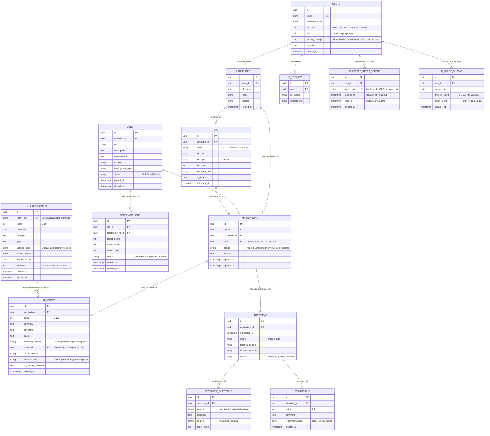

# Thiết kế cơ sở dữ liệu

> TV1 phụ trách tài liệu này. Cập nhật tuần 3 (chốt quy ước tên cột/enum để SQL báo cáo và EF
> của các module khớp nhau — mục 2.1).

PostgreSQL 16. **Một `AtsDbContext` dùng chung, tách bảng theo schema** để giữ ranh giới module
mà vẫn dễ migration/join.

## 1. Sơ đồ ER (mermaid)



## 2. Bảng theo schema

Nguyên tắc chia schema: **bảng thuộc schema của module sở hữu entity tương ứng trong code.**
`identity` chỉ giữ thứ phục vụ xác thực; hồ sơ nghiệp vụ thuộc `recruitment` vì `Candidate` là
entity của `Recruitment.Domain` (`ICandidateRepository` nằm ở đó, xem `contracts.md` mục 2.1).

### Schema `identity`

| Bảng | Mục đích |
|---|---|
| `identity.users` | Tài khoản chung — cả Ứng viên, HR, Admin: email + mật khẩu + vai + **`full_name`** |
| `identity.password_reset_tokens` | Token "quên mật khẩu", lưu **hash**, hết hạn 30 phút, dùng một lần |

> **Lệch so với ERD bản tuần 1 — có chủ đích:** `identity.users` có thêm cột `full_name`.
> JWT phải mang claim `name` (contracts.md mục 8.1) và Admin xem danh sách user kèm họ tên
> (`UserDto.FullName`) cho cả tài khoản HR/Admin — những tài khoản không có dòng `candidates`.
> Đọc họ tên từ `recruitment.*` thì Identity phải tham chiếu chéo module. `candidates.full_name`
> vẫn giữ (hồ sơ ứng viên có thể sửa riêng).

### Schema `recruitment`

| Bảng | Mục đích |
|---|---|
| `recruitment.candidates` | Hồ sơ cá nhân của Ứng viên (1-1 với `users` khi role=Candidate) |
| `recruitment.hr_profiles` | Hồ sơ HR (1-1 với `users` khi role=HR) |
| `recruitment.cvs` | Nhiều CV/ứng viên — điểm khác biệt so với bản trước |
| `recruitment.jobs` | Tin tuyển dụng, HR sở hữu |
| `recruitment.applications` | Bản đơn ứng tuyển: candidate + job + **cv** + trạng thái |
| `recruitment.interviews` | Buổi phỏng vấn của một application |
| `recruitment.evaluations` | Đánh giá sau phỏng vấn |

### Schema `aiscreening`

| Bảng | Mục đích |
|---|---|
| `aiscreening.ai_scores` | **Ảnh chụp** điểm AI của một đơn ứng tuyển — thứ HR đã nhìn thấy |
| `aiscreening.ai_score_cache` | **Kho tra cứu** theo nội dung, không gắn với đơn nào |
| `aiscreening.screening_jobs` | Lô sàng lọc HR chạy (tracking tiến độ) |
| `aiscreening.interview_questions` | Câu hỏi phỏng vấn (nguồn: AI/Manual/Template) |
| `aiscreening.ai_usage_quotas` | Bộ đếm hạn mức AI theo (user, ngày) — hiện thực RB2 |

### 2.1. Quy ước tên cột và kiểu (chốt tuần 3)

SQL báo cáo (`ATS.Persistence/Reporting`, TV1) viết tay theo đúng các quy ước này vì
`ATS.Persistence` không thấy entity của module. Đổi tên property entity = báo TV1 sửa SQL.

- Bảng/cột **snake_case tự động** (`UseSnakeCaseNamingConvention`): `HrOwnerId` → `hr_owner_id`.
  Mỗi `IEntityTypeConfiguration` chỉ đặt `ToTable("<tên>", AtsDbContext.<Schema>Schema)`.
- **Enum lưu dạng chuỗi** (`HasConversion<string>()`), giá trị đúng tên enum: `jobs.status` ∈
  `Draft|Open|Closed`, `applications.status` ∈ `Applied|Screening|Interview|Hired|Rejected`,
  `ai_scores.screening_status` ∈ `Pending|Processing|Scored|Failed`, `adapter_used` ∈
  `OpenAI|Embedding|Keyword|Fake`, `users.role` ∈ `Candidate|Hr|Admin` (tên enum `Role.Hr`; chuỗi
  `"HR"` chỉ xuất hiện ở JWT/API), `jobs.employment_type` ∈ `FullTime|PartTime|Internship|Contract`,
  `interviews.status` ∈ `Scheduled|Done|Cancelled`, `evaluations.recommendation` ∈ `Hire|Reject|Consider`,
  `screening_jobs.status` ∈ `Queued|Running|Done|Cancelled`.
- Cột phát sinh khi code (so với ERD mục 1): `users.full_name`, `jobs.created_at`,
  `interviews.email_sent`, `interviews.created_at`, `ai_scores.failure_reason`, `ai_scores.updated_at`,
  `interview_questions.created_at`. `strengths`/`gaps` là mảng JSON lưu trong cột `text`.
- Mọi thời gian là `DateTimeOffset` UTC → `timestamp with time zone`. Khoá chính `uuid`, sinh ở
  code (`Guid.CreateVersion7()`).
- `jobs.hr_owner_id` = `identity.users.id` của HR (không phải `hr_profiles.id`); `ai_scores.score`
  cho phép NULL (chưa chấm / Failed).

| Truy vấn dashboard (`GET /api/reports/dashboard`) | Bảng / cột dùng |
|---|---|
| Số tin, tin đang mở | `recruitment.jobs(status, hr_owner_id)` |
| Đơn theo trạng thái, tỉ lệ Hired, top 5 tin | `recruitment.applications(job_id, status)` ⋈ `jobs` |
| Điểm AI theo trạng thái / adapter | `aiscreening.ai_scores(application_id, screening_status, adapter_used)` ⋈ `applications` ⋈ `jobs` |
| Tỉ lệ cache hit (RB2) = `Σhit_count / (Σhit_count + số dòng)` | `aiscreening.ai_score_cache(hit_count)` — luôn toàn hệ thống |

HR chỉ thấy số liệu của tin `hr_owner_id = <mình>`; Admin thấy toàn hệ thống.

#### `ai_scores` và `ai_score_cache` khác nhau chỗ nào

Đây là hai khái niệm khác nhau, gộp chung là sai:

| | `ai_score_cache` | `ai_scores` |
|---|---|---|
| Khoá theo | **Nội dung**: CV + JD + model + prompt | **Đơn ứng tuyển**: `application_id` |
| Tồn tại khi chưa có đơn? | **Có** — ứng viên preview trước khi nộp (UC-05) | Không |
| Dùng lại giữa nhiều đơn? | Có — 2 ứng viên nộp cùng một CV vào cùng tin thì trúng chung | Không |
| Khi đổi `prompt_version` | Dòng cũ thành vô dụng, ghi dòng mới | Giữ nguyên — đó là điểm HR đã thấy |

Vì vậy `ai_scores` sao chép lại `score`/`summary` tại thời điểm chấm thay vì chỉ trỏ sang
cache. Trùng lặp này **là cố ý**: nếu sau đó nhóm đổi prompt, hồ sơ vẫn còn đúng con số mà HR
đã căn cứ để ra quyết định.

## 3. Ràng buộc dữ liệu quan trọng

1. **`applications.cv_id` phải thuộc về đúng `applications.candidate_id`.** Kiểm ở Application
   layer (TV2) **và** ở DB bằng FK kép `(cv_id, candidate_id) → cvs(id, candidate_id)`
   (`fk_applications_cv_owner`, mục 5) — không cần trigger.
2. **`(application_id)` là UNIQUE trong `ai_scores`.** Một đơn có tối đa một điểm AI (chấm lại thì
   update, không insert dòng mới).
3. **`cache_key` là UNIQUE trong `ai_score_cache`**, giá trị
   `SHA256(cv_text || jd_text || model_version || prompt_version)`. Bảng này **không có**
   `application_id` — đó chính là lý do phải tách khỏi `ai_scores`: ứng viên xem preview khi
   chưa nộp đơn (UC-05), lúc đó chưa tồn tại `Application` nào để tham chiếu. Mọi lượt chấm,
   preview lẫn sàng lọc lô, đều tra bảng này trước khi gọi LLM.
4. **`cvs.is_default`**: chỉ 1 CV `is_default=true` per candidate (partial unique index).
5. **`applications` không được xóa vật lý**, chỉ set `status=Rejected` — để giữ lịch sử.
6. **`(user_id, usage_date)` là UNIQUE trong `ai_usage_quotas`.** Tăng bộ đếm bằng
   `INSERT ... ON CONFLICT (user_id, usage_date) DO UPDATE SET preview_count = preview_count + 1`
   — một câu lệnh nguyên tử, không cần lock ở tầng ứng dụng.
7. **`password_reset_tokens` lưu `token_hash`, không lưu token thô.** Rò database thì kẻ tấn
   công vẫn không đặt lại được mật khẩu. Token dùng một lần (`used_at`), hết hạn sau 30 phút.
8. **`ai_scores.cache_id` cho phép NULL.** Khi `KeywordScoringAdapter` chạy (không gọi LLM,
   không tốn tiền) thì không cần ghi cache.

## 4. Index

| Bảng | Cột | Loại | Vì sao |
|---|---|---|---|
| `applications` | `(job_id, status)` | btree | HR lọc theo tin + trạng thái |
| `applications` | `(candidate_id)` | btree | Ứng viên xem lịch sử |
| `ai_score_cache` | `cache_key` | unique btree | Lookup cache trước khi gọi LLM |
| `ai_scores` | `application_id` unique, `INCLUDE (score, screening_status)` | btree | Covering index cho truy vấn xếp hạng dưới đây |
| `ai_usage_quotas` | `(user_id, usage_date)` | unique btree | Đếm hạn mức trong ngày (RB2) |
| `password_reset_tokens` | `token_hash` | unique btree | Tra token khi đặt lại mật khẩu |
| `cvs` | `(candidate_id, is_default)` partial | btree | Tìm CV default |
| `users` | `email` | unique | Đăng nhập |

### 4.1. Vì sao không có index `(application_id, score DESC)`

Truy vấn nghiệp vụ thật không phải "xếp hạng theo `application_id`" mà là **"xếp hạng ứng viên
của tin X theo điểm giảm dần"**. Mà `ai_scores` **không có** cột `job_id`:

```sql
SELECT a.id, a.candidate_id, s.score, s.summary, s.adapter_used
FROM   recruitment.applications a
LEFT   JOIN aiscreening.ai_scores s ON s.application_id = a.id
WHERE  a.job_id = @jobId
ORDER  BY s.score DESC NULLS LAST;
```

Lọc xảy ra ở `applications(job_id, status)`; `ai_scores` chỉ bị tra theo `application_id`, mà
cột đó là UNIQUE — mỗi khoá đúng một dòng, nên thêm `score DESC` vào index **không sắp xếp
được gì cả**. Index đúng là index **covering**: `INCLUDE (score, screening_status)` để phép
join lấy luôn điểm mà không phải đọc heap.

`LEFT JOIN` + `NULLS LAST` là bắt buộc, không phải tuỳ chọn: hồ sơ chưa chấm hoặc "Không chấm
được" vẫn phải hiện trong danh sách (RB9).

**Dấu hiệu phải xem lại:** khi một tin có > 5.000 hồ sơ và phép join thành nút cổ chai → lúc
đó mới thêm `job_id` denormalized vào `ai_scores` kèm index `(job_id, score DESC)`, và chấp
nhận phải giữ đồng bộ cột đó.

## 5. Migration

**Hiện trạng:** hai migration.

| Migration | Nội dung |
|---|---|
| `20260919131605_InitialCreate` (tuần 2) | Chỉ tạo 3 schema (viết tay — EF không sinh `EnsureSchema` khi model rỗng) |
| `20261116055018_AddModuleTables` (pha tích hợp) | 14 bảng: `identity` 2, `recruitment` 7, `aiscreening` 5 + mọi index/FK trong module + phần viết tay bên dưới |

**Quy trình đã chốt:** tuần 3 ba nhánh (Identity/Recruitment của TV2, AiScreening của TV4, hạ
tầng của TV1) phát triển song song và **không nhánh nào tự tạo migration** — ba nhánh cùng sửa
`AtsDbContextModelSnapshot.cs` thì merge chắc chắn xung đột và snapshot sai. Sau khi merge đủ
các nhánh vào `nvhung`, TV1 sinh **một** migration duy nhất cho toàn bộ bảng
(`dotnet ef migrations add ... --project src/Shared/ATS.Persistence --startup-project src/Hosts/ATS.Api`),
rồi chạy thử trên Postgres thật (compose) trước khi đẩy lên.

- Migration nằm trong `ATS.Persistence/Migrations`, startup project là `ATS.Api` (Composition Root
  thật — model lúc sinh migration và lúc chạy là một).
- Áp lúc khởi động **chỉ khi** `Database:AutoMigrate=true` (compose bật sẵn cho dev/demo), và
  **chỉ API** migrate — worker không bao giờ migrate (tránh hai process tranh khoá
  `__EFMigrationsHistory`).
- Không split migration theo module ở phase 1 — split khi nào thực sự tách microservices.

Hai index đặc biệt **EF đã tự sinh** từ model (không cần viết tay):
`ix_cvs_default` (unique, `WHERE is_default` — `HasFilter`) và `ix_ai_scores_application_id`
(unique, `INCLUDE (score, screening_status)` — `IncludeProperties`).

Phần **viết tay** trong `AddModuleTables` (`migrationBuilder.Sql`, có `Down` tương ứng) — những thứ
model không thể biết vì module không thấy entity của nhau:

```sql
-- FK xuyên schema/module, DEFERRABLE INITIALLY DEFERRED: EF không biết thứ tự INSERT giữa hai
-- bảng này (đăng ký = users + candidates trong CÙNG một SaveChanges) nên kiểm lúc COMMIT.
recruitment.candidates.user_id       → identity.users(id)
recruitment.hr_profiles.user_id      → identity.users(id)
recruitment.jobs.hr_owner_id         → identity.users(id)
aiscreening.ai_scores.application_id → recruitment.applications(id)
aiscreening.interview_questions.interview_id → recruitment.interviews(id)
aiscreening.screening_jobs.job_id    → recruitment.jobs(id)
aiscreening.ai_usage_quotas.user_id  → identity.users(id)

-- Ràng buộc 1 (mục 3): CV của đơn phải thuộc đúng ứng viên nộp đơn.
CREATE UNIQUE INDEX ux_cvs_id_candidate_id ON recruitment.cvs (id, candidate_id);
ALTER TABLE recruitment.applications ADD CONSTRAINT fk_applications_cv_owner
  FOREIGN KEY (cv_id, candidate_id) REFERENCES recruitment.cvs (id, candidate_id);
```

Không có `ON DELETE CASCADE` xuyên module: `users` và `applications` không bao giờ bị xoá vật lý.

**Sinh lại migration** (máy Windows bật Smart App Control chặn `dotnet ef` nạp DLL → chạy trong WSL):
`dotnet tool restore` rồi
`dotnet dotnet-ef migrations add <Tên> --project src/Shared/ATS.Persistence --startup-project src/Hosts/ATS.Api`.

## 6. Seed data cho dev

Seed viết bằng C# (`ATS.Persistence/DatabaseSeeder.cs`), **không** phải `docker/seed.sql`: script
SQL chạy lúc container `db` khởi động sẽ chạy TRƯỚC khi API migrate, tức là trước khi bảng tồn
tại; và hash mật khẩu (BCrypt) phải sinh giống hệt cách Identity kiểm tra.

- Chạy trong API, **sau** `MigrateAsync`, khi `Database:AutoMigrate=true` **và**
  `Database:SeedDemoData=true` (compose: `DB_SEED_DEMO_DATA`, mặc định `true` cho dev).
- Viết bằng **SQL thô** (`ATS.Persistence` không thấy entity của module), MỘT transaction.
- **Idempotent**: mọi dòng có Id CỐ ĐỊNH (`5eed00TT-0000-0000-0000-NNNNNNNNNNNN`, `DemoData.cs`) và
  `ON CONFLICT DO NOTHING`; nếu HR demo đầu tiên (hoặc bất kỳ email demo nào) đã tồn tại thì bỏ
  qua cả khối. Đã chạy 2 lần trên Postgres 16 thật: số dòng không đổi.
- Admin **không** do seeder này tạo: `AdminSeeder` của Identity (TV2) tạo từ `Seed:AdminEmail` /
  `Seed:AdminPassword` (mặc định dev `admin@ats.local` / `Admin@123` — deploy thật **phải** đổi
  trong `docker/.env`).
- File CV demo là **PDF thật** (sinh trong code, `DemoPdf.cs`) ghi vào `FileStorage:RootPath`
  (`seed-cv-NN.pdf`) nếu chưa có — `GET /api/applications/{id}/cv-file` tải được, kể cả khi volume
  `cv-files` bị xoá mà database còn (file được ghi lại ở lần khởi động sau).

Tài khoản demo (mật khẩu chung **`Demo@123`**, chỉ dùng cho dev/demo):

| Vai | Email | Ghi chú |
|---|---|---|
| Admin | `admin@ats.local` / `Admin@123` | do `AdminSeeder` tạo |
| HR | `hr1@ats.local` | 4 tin (1 Draft), có lô sàng lọc đã xong, có lịch phỏng vấn |
| HR | `hr2@ats.local` | 3 tin (1 Closed) |
| HR | `hr3@ats.local` | 3 tin |
| Ứng viên | `ungvien1@ats.local` … `ungvien8@ats.local` | ứng viên 1–4 có 2 CV, 5–8 có 1 CV |

Dữ liệu: 3 HR, 8 ứng viên, 12 CV (có `extracted_text`), 10 tin (8 Open, 1 Draft, 1 Closed),
30 đơn (8 Applied, 7 Screening, 6 Interview, 3 Hired, 6 Rejected), 30 `ai_scores` (Scored với
đủ 4 adapter `Fake`/`Keyword`/`OpenAI`/`Embedding`, 3 Failed, 3 Pending), 6 dòng `ai_score_cache`
(tổng `hit_count` = 19), 1 lô sàng lọc Done, 4 buổi phỏng vấn (2 sắp tới, 2 đã xong) + 2 đánh
giá + 3 câu hỏi. Demo chạy **không cần** `OPENAI_API_KEY` (`AiProvider=Fake`).

## 7. Backup & retention

- CV file gốc: lưu trong volume `cv-files` (`/app/data/cvs`, khoá `FileStorage:RootPath`) — không
  backup (đồ án học). `cvs.file_path` chỉ chứa **tên file do hệ thống sinh** (Guid v7 + đuôi), tương
  đối với thư mục gốc; `LocalFileStorage` từ chối mọi đường dẫn tuyệt đối hoặc thoát ra ngoài gốc.
- Database: `pg_dump` thủ công trước mỗi lần deploy demo
- PII: không log query có `full_name`, `phone`, `email` (RB3)
